# User Registration and Authentication Flow Implementation Plan

## Goal Description
Implement an end-to-end user registration and authentication flow in the Spring Boot application using Spring Security, Spring MVC, Spring Data JPA, H2, and Thymeleaf integrated with the **CoreUI 5.6.1 Admin Template CSS** (`css/style.css`, `css/vendors/simplebar.css`, `css/examples.css`) and scripts (`js/config.js`, `js/color-modes.js`).

This will provide:
1. **User Registration Flow**: Users can navigate to `/authentication/register`, view a CoreUI admin template styled registration interface, submit their details (username, email, password), pass validation and uniqueness checks, have their password securely hashed with BCrypt, and persist in H2 database.
2. **User Authentication Flow**: Users can navigate to `/authentication/login` (or `/login`), view a CoreUI admin template styled login card, authenticate with username or email and password, and be redirected to a protected dashboard (`/`). Unauthenticated users attempting to access protected endpoints are redirected to `/authentication/login`. Logging out clears the session and returns to login with a confirmation message.

---

## Alignment with AGENTS.md

In accordance with [AGENTS.md](file:///home/allen/workspace/ai/AGENTS.md):
- **Frontend Assets & CoreUI Admin Template CSS**:
  - Integrate **CoreUI 5.6.1** stylesheets:
    - Primary Admin Stylesheet: `src/main/resources/static/css/style.css` (linked via `th:href="@{/css/style.css}"`)
    - Vendor Stylesheet: `src/main/resources/static/css/vendors/simplebar.css` (linked via `th:href="@{/css/vendors/simplebar.css}"`)
    - Layout & Example Helpers: `src/main/resources/static/css/examples.css` (linked via `th:href="@{/css/examples.css}"`)
  - Include CoreUI configuration and color-mode scripts (`js/config.js`, `js/color-modes.js`) to support responsive layouts and CoreUI dark/light theme switching.
  - Utilize CoreUI admin template UI components: `.card`, `.card-body`, `.form-control`, `.form-label`, `.input-group`, `.btn-primary`, `.btn-outline`, `.alert`, and flex utility containers (`.min-vh-100`, `.bg-body-tertiary`).
- **Package Hierarchy**: All Java code adheres to the defined structure:
  - `com.allensandiego.ai.config`
  - `com.allensandiego.ai.controller`
  - `com.allensandiego.ai.dto`
  - `com.allensandiego.ai.model`
  - `com.allensandiego.ai.repository`
  - `com.allensandiego.ai.service`
- **Template Layout**: Templates are placed in `src/main/resources/templates/` with auth pages under `src/main/resources/templates/authentication/`.
- **Database Assets**: `application.properties`, `schema.sql`, and `data.sql` are aligned to ensure consistent table naming (`users`) and execution order.
- **Testing and Screenshots**: Tests are placed in `src/test/java/com/allensandiego/ai/`. All Playwright screenshots are output strictly under `target/screenshots/`.
- **Build and Run Commands**: Using `./mvnw test`, `./mvnw package`, and `./mvnw spring-boot:run`.

---

## User Review Required

> [!IMPORTANT]
> **Database Table Naming & Seed Data Alignment**:
> In `src/main/resources/schema.sql`, the table was previously named `user`, whereas in `src/main/resources/data.sql` the insert was into `users` (`insert into users ...`). In SQL and H2, `USER` is a reserved keyword. We align the table name to `users` across `schema.sql`, `data.sql`, and `@Table(name = "users")`.

> [!NOTE]
> **Login Identifier**:
> The login form will allow users to authenticate using either their **username** or their **email address**, providing a smooth user experience.

> [!NOTE]
> **Validation Starter Dependency**:
> We will add `spring-boot-starter-validation` to `pom.xml` to leverage declarative Jakarta Bean Validation (`@NotBlank`, `@Email`, `@Size`) on the registration DTO.

---

## Open Questions

None currently blocking.

---

## Proposed Changes

```mermaid
flowchart TD
    subgraph Registration Flow
        RegForm["User visits /authentication/register<br/>(Rendered with CoreUI Admin CSS)"] --> SubmitReg["POST /authentication/register"]
        SubmitReg --> ValidateDTO{"Validation & Uniqueness Check"}
        ValidateDTO -- Invalid --> RegErrors["Re-render /authentication/register with CoreUI .invalid-feedback"]
        ValidateDTO -- Valid --> HashPW["BCryptPasswordEncoder hashes password"]
        HashPW --> SaveDB["UserRepository.save(user)"]
        SaveDB --> RedirectLogin["Redirect to /authentication/login?registered=true"]
    end

    subgraph Authentication Flow
        LoginForm["User visits /authentication/login<br/>(Rendered with CoreUI Admin CSS)"] --> SubmitLogin["POST /authentication/login"]
        SubmitLogin --> AuthProvider["CustomUserDetailsService loadUserByUsername"]
        AuthProvider --> CheckCreds{"Password matches BCrypt hash?"}
        CheckCreds -- No --> LoginFail["Redirect /authentication/login?error=true<br/>(CoreUI .alert-danger)"]
        CheckCreds -- Yes --> SessionCreated["Create SecurityContext & Session"]
        SessionCreated --> ProtectedHome["Redirect to / (Dashboard with CoreUI Layout)"]
    end
```



---

### Dependency & Build

#### [MODIFY] [pom.xml](file:///home/allen/workspace/ai/pom.xml)
- Add `spring-boot-starter-validation` to support Jakarta validation annotations (`@NotBlank`, `@Email`, `@Size`) on form DTOs.

```xml
<dependency>
    <groupId>org.springframework.boot</groupId>
    <artifactId>spring-boot-starter-validation</artifactId>
</dependency>
```

---

### Database & Configuration

#### [MODIFY] [schema.sql](file:///home/allen/workspace/ai/src/main/resources/schema.sql)
- Align table name to `users`:
```sql
drop table if exists users;

create table users (
  id bigint primary key auto_increment,
  username varchar(255) not null unique,
  password varchar(255) not null,
  email varchar(255) not null unique,
  created_at timestamp default current_timestamp
);
```

#### [MODIFY] [application.properties](file:///home/allen/workspace/ai/src/main/resources/application.properties)
- Configure JPA initialization so SQL scripts run harmoniously with JPA entity management:
```properties
spring.jpa.defer-datasource-initialization=true
spring.sql.init.mode=always
```

---

### Domain Model, DTO & Persistence

#### [NEW] [User.java](file:///home/allen/workspace/ai/src/main/java/com/allensandiego/ai/model/User.java)
- Entity mapped to table `users`.
- Package: `com.allensandiego.ai.model`.
- Fields:
  - `Long id` (`@Id`, `@GeneratedValue(strategy = GenerationType.IDENTITY)`)
  - `String username` (`@Column(nullable = false, unique = true)`)
  - `String email` (`@Column(nullable = false, unique = true)`)
  - `String password` (`@Column(nullable = false)`)
  - `LocalDateTime createdAt` (defaults to `LocalDateTime.now()` on `@PrePersist`)
- Lombok `@Getter`, `@Setter`, `@NoArgsConstructor`, `@AllArgsConstructor`, `@Builder`.

#### [NEW] [UserRegistrationDto.java](file:///home/allen/workspace/ai/src/main/java/com/allensandiego/ai/dto/UserRegistrationDto.java)
- Backing form DTO for registration:
  - Package: `com.allensandiego.ai.dto`.
  - `@NotBlank(message = "Username is required") @Size(min = 3, max = 50, message = "Username must be between 3 and 50 characters") String username`
  - `@NotBlank(message = "Email is required") @Email(message = "Please provide a valid email address") String email`
  - `@NotBlank(message = "Password is required") @Size(min = 6, message = "Password must be at least 6 characters") String password`
  - `String confirmPassword`
  - `boolean termsAccepted`

#### [NEW] [UserRepository.java](file:///home/allen/workspace/ai/src/main/java/com/allensandiego/ai/repository/UserRepository.java)
- Package: `com.allensandiego.ai.repository`.
- Extends `JpaRepository<User, Long>`:
  - `Optional<User> findByUsername(String username)`
  - `Optional<User> findByEmail(String email)`
  - `Optional<User> findByUsernameOrEmail(String username, String email)`
  - `boolean existsByUsername(String username)`
  - `boolean existsByEmail(String email)`

---

### Service Layer & Security

#### [NEW] [UserService.java](file:///home/allen/workspace/ai/src/main/java/com/allensandiego/ai/service/UserService.java)
- Package: `com.allensandiego.ai.service`.
- Business logic for user registration:
  - Validates uniqueness for username and email.
  - Verifies confirmation password matches.
  - Encodes password using `PasswordEncoder`.
  - Saves `User` entity to database.

#### [NEW] [CustomUserDetailsService.java](file:///home/allen/workspace/ai/src/main/java/com/allensandiego/ai/service/CustomUserDetailsService.java)
- Package: `com.allensandiego.ai.service`.
- Implements Spring Security's `UserDetailsService`.
- `loadUserByUsername(String usernameOrEmail)`:
  - Searches by `findByUsernameOrEmail(usernameOrEmail, usernameOrEmail)`.
  - Returns `org.springframework.security.core.userdetails.User` with granted authority `ROLE_USER`.

#### [MODIFY] [SecurityConfig.java](file:///home/allen/workspace/ai/src/main/java/com/allensandiego/ai/config/SecurityConfig.java)
- Package: `com.allensandiego.ai.config`.
- Provide `PasswordEncoder` bean (`BCryptPasswordEncoder`).
- Configure HTTP security:
  - Permit requests to: `/authentication/**`, `/login`, `/register`, `/css/**`, `/js/**`, `/images/**`, `/vendors/**`, `/error`.
  - Require authentication for all other requests (e.g. `/`, `/dashboard`).
  - Configure form login:
    - `.loginPage("/authentication/login")`
    - `.loginProcessingUrl("/authentication/login")`
    - `.defaultSuccessUrl("/", true)`
    - `.failureUrl("/authentication/login?error=true")`
    - `.usernameParameter("username")`
    - `.passwordParameter("password")`
    - `.permitAll()`
  - Configure logout:
    - `.logoutUrl("/authentication/logout")`
    - `.logoutSuccessUrl("/authentication/login?logout=true")`
    - `.invalidateHttpSession(true)`
    - `.deleteCookies("JSESSIONID")`
    - `.permitAll()`

---

### Web Controllers

#### [NEW] [AuthenticationController.java](file:///home/allen/workspace/ai/src/main/java/com/allensandiego/ai/controller/AuthenticationController.java)
- Package: `com.allensandiego.ai.controller`.
- Handles authentication-related views and actions:
  - `GET /authentication/login`: returns `authentication/login` view.
  - `GET /login`: redirects to `/authentication/login`.
  - `GET /authentication/register`: returns `authentication/register` view with a new `UserRegistrationDto` model attribute.
  - `GET /register`: redirects to `/authentication/register`.
  - `POST /authentication/register`:
    - Validates `@Valid @ModelAttribute("user") UserRegistrationDto dto, BindingResult bindingResult, Model model`.
    - If passwords do not match or fields invalid or username/email taken, returns `authentication/register` with error alerts.
    - If valid, calls `userService.register(dto)` and redirects to `/authentication/login?registered=true`.

#### [NEW] [HomeController.java](file:///home/allen/workspace/ai/src/main/java/com/allensandiego/ai/controller/HomeController.java)
- Package: `com.allensandiego.ai.controller`.
- Handles protected home/dashboard:
  - `GET /`: returns `index` view with the authenticated user's details.

---

### Thymeleaf Templates & CoreUI Admin Template CSS Integration

All templates leverage the project's **CoreUI 5.6.1 Admin Template** CSS and JavaScript assets:
```html
<!-- CoreUI Admin Template CSS Dependencies -->
<link rel="stylesheet" th:href="@{/css/vendors/simplebar.css}">
<link rel="stylesheet" th:href="@{/css/style.css}">
<link rel="stylesheet" th:href="@{/css/examples.css}">
<script th:src="@{/js/config.js}"></script>
<script th:src="@{/js/color-modes.js}"></script>
```

#### [NEW] [login.html](file:///home/allen/workspace/ai/src/main/resources/templates/authentication/login.html)
- Uses CoreUI Admin Template layout structure:
  - Wrapper container: `<div class="bg-body-tertiary min-vh-100 d-flex flex-row align-items-center">`
  - CoreUI card: `<div class="card p-4">`, `<div class="card-body d-flex flex-column gap-4">`
  - Heading: `<h2 class="h5 text-center">Login to your account</h2>` (matching Playwright test).
- CoreUI alert components:
  - Alert on `param.error`: `<div class="alert alert-danger" role="alert">Invalid username or password. Please try again.</div>`
  - Alert on `param.logout`: `<div class="alert alert-success" role="alert">You have been logged out successfully.</div>`
  - Alert on `param.registered`: `<div class="alert alert-success" role="alert">Account registered successfully! Please log in.</div>`
- Form submitting via POST to `/authentication/login` with `th:action="@{/authentication/login}"`:
  - Username/Email: `<input class="form-control" id="username" name="username" type="text" placeholder="Username or email" required>`
  - Password: `<input class="form-control" id="password" name="password" type="password" placeholder="Your password" required>`
  - Submit button: `<button class="btn btn-primary w-100" type="submit">Sign in</button>`
  - Link to `/authentication/register`: `<a th:href="@{/authentication/register}">Sign up</a>`

#### [NEW] [register.html](file:///home/allen/workspace/ai/src/main/resources/templates/authentication/register.html)
- Uses CoreUI Admin Template layout structure:
  - Wrapper: `<div class="bg-body-tertiary min-vh-100 d-flex flex-row align-items-center">`
  - Card container: `<div class="card p-4">`
  - Heading: `<h2 class="h5 text-center">Create new account</h2>`
- Form binding to `user` (`th:object="${user}"`, `th:action="@{/authentication/register}"`, `method="post"`):
  - Form validation with CoreUI `.is-invalid` and `<div class="invalid-feedback">`:
    - `username` input (`th:field="*{username}"`)
    - `email` input (`th:field="*{email}"`)
    - `password` input (`th:field="*{password}"`)
    - `confirmPassword` input (`th:field="*{confirmPassword}"`)
    - Terms checkbox (`.form-check`, `.form-check-input`)
  - Submit button: `<button class="btn btn-primary w-100" type="submit">Create new account</button>`
  - Link to `/authentication/login`: `<a th:href="@{/authentication/login}">Sign in</a>`

#### [NEW] [index.html](file:///home/allen/workspace/ai/src/main/resources/templates/index.html)
- Authenticated dashboard/landing page with CoreUI Admin Template navigation and card layout:
  - CoreUI sidebar/header and card container: `<div class="card mb-4">`
  - Displays authenticated user info (`<span sec:authentication="name"></span>`).
  - Includes a logout form button posting to `/authentication/logout` styled with `<button class="btn btn-outline-danger" type="submit">Sign out</button>`.

---

## Verification Plan

### Automated Tests
1. **Existing Playwright Test**:
   - Run `./mvnw test -Dtest=AiApplicationTests#opensLoginPageAndSavesScreenshot`
   - Verifies `/login` navigation returns HTTP 200, renders "Login to your account", and saves `target/screenshots/login-page.png`.
2. **Registration & Auth Playwright Tests**:
   - Add Playwright E2E tests in `AiApplicationTests` (package `com.allensandiego.ai`):
     - Test complete registration flow: navigate to `/register`, fill out form with new unique user, submit, verify redirect to `/authentication/login?registered=true`, and save screenshot to `target/screenshots/register-page.png`.
     - Test authentication with registered user: fill in credentials, submit, verify redirect to `/` displaying user name, and save screenshot to `target/screenshots/dashboard.png`.
     - Test failed authentication: fill in wrong password, verify `/authentication/login?error=true` shows error alert, and save screenshot to `target/screenshots/login-error.png`.
     - Test logout: click logout, verify redirect back to `/authentication/login?logout=true`.
3. **Service & Repository Unit/Integration Tests**:
   - Add unit/slice tests in `src/test/java/com/allensandiego/ai/` verifying:
     - Password hashing with BCrypt.
     - Validation failure when username or email is already registered.
     - Successful persistence and retrieval via `UserRepository`.
4. **Full Test Suite & Package Build**:
   - `./mvnw test`
   - `./mvnw package`

### Manual Verification
1. Run `./mvnw spring-boot:run`.
2. Open browser to `http://localhost:8080/`. Verify immediate redirect to `/authentication/login` with CoreUI admin styling applied.
3. Click "Sign up" to go to `/authentication/register`.
4. Try submitting an empty form or mismatched passwords; verify CoreUI invalid feedback messages display properly.
5. Fill in valid registration details and submit; verify redirection to login with CoreUI success alert.
6. Log in with the registered username and password; verify landing on `/` with username displayed.
7. Click "Sign out"; verify redirection to login page with logout alert.
